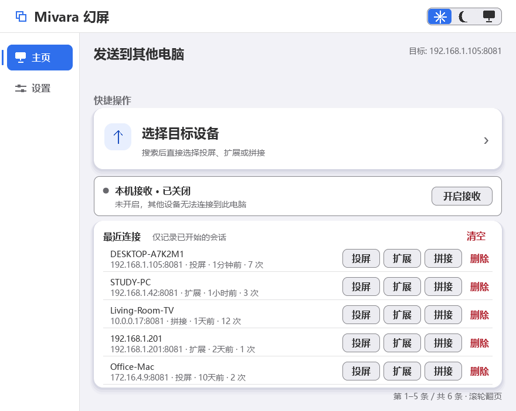
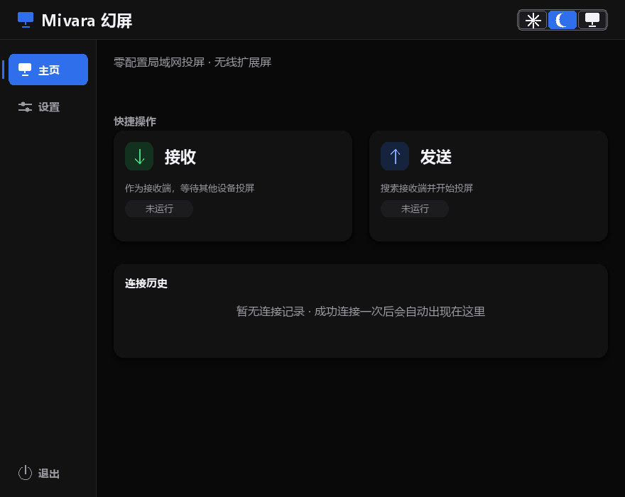
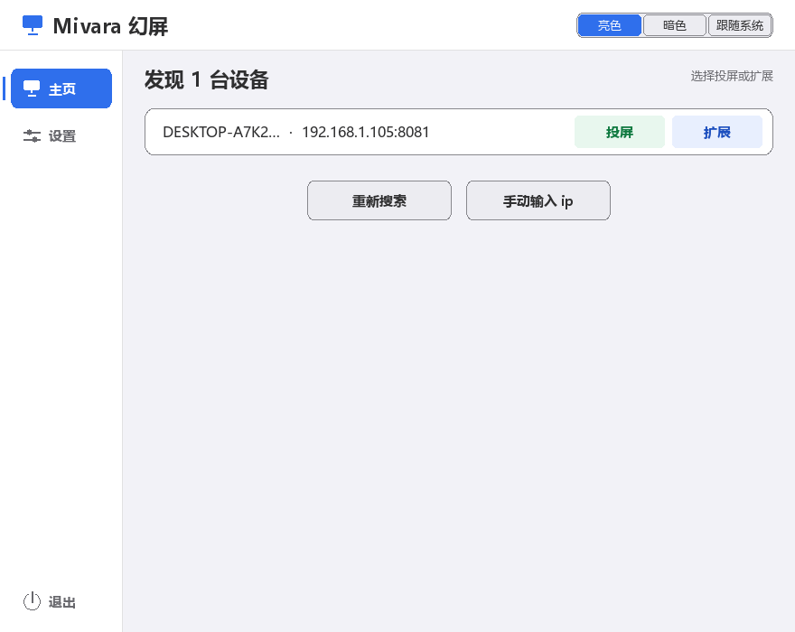
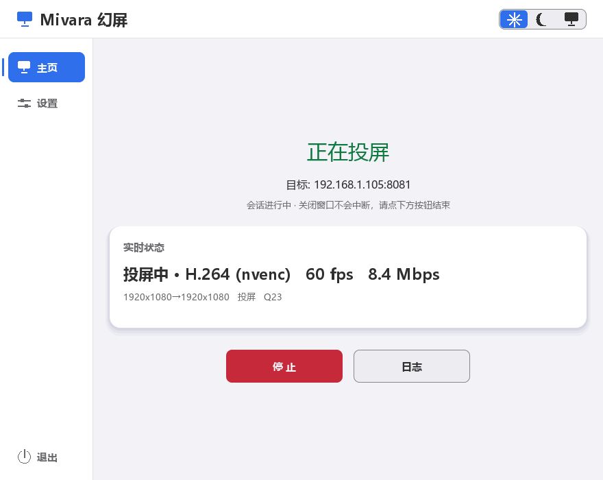

# User Guide

> [Docs index](../README.md) · [Back to README](../../README_EN.md) · [中文](../zh/usage.md)

Mivara is a lightweight, cross-platform **screen extension / casting** tool. The sender captures the local screen and streams it over the network to the receiver, which displays it fullscreen.

Two display modes are provided, plus a "stitch" mode that sends no picture at all:

1. **Mirror** — the receiver shows the sender's primary screen in full (demos and presentations).
2. **Extend** — the sender **automatically activates a virtual display**, creating a real desktop workspace; windows and the mouse can be dragged into this "invisible screen" and the receiver shows it in real time. The virtual display is detached when the session ends.
3. **Stitch (software KVM)** — both PCs keep their own monitors and **share one keyboard and mouse**: choose which side of this PC the peer sits on (left / right / top / bottom) when starting, push the cursor out of that edge to take over the peer, and move back out of the peer's facing edge (or press Ctrl+Alt+Shift+Q) to hand control back. The side can be switched at any time during the session. No capture, no encoder, no virtual display; Windows ↔ Windows only.

Extend mode requires a Windows indirect display driver (IddCx); see [Virtual Display Driver](virtual-display.md) for installation. The driver only needs to be installed once — attaching/detaching the virtual display is managed automatically during the session.

This page covers day-to-day use: the interface and capabilities first, then connecting by display mode. For discovery, handshakes and streaming internals, see [Architecture & Protocol](architecture.md).

## Screenshots

The GUI is Chinese-only; the screenshots below show the Home screen (light/dark), device discovery, and an active stream:

| Home (light) | Home (dark) |
|:---:|:---:|
|  |  |

| Device discovery | Streaming |
|:---:|:---:|
|  |  |

## Features

| Category | Capability |
|----------|-----------|
| **Extend mode** | Virtual display auto-enabled and attached at session start; on every exit path (normal end / Ctrl+C / disconnect / console close / hard-kill fallback) it is detached and the device is disabled, so it vanishes from system settings completely |
| **Virtual display integration** | Activation/deactivation/positioning done in-process via the CCD API — no manual display-settings fiddling |
| **Video codecs** | H.264 / H.265 / AV1 (FFmpeg), hardware-first (NVENC/QSV/AMF/VAAPI) with automatic software fallback (libx264/libx265/SVT-AV1); raw/RLE lossless options kept |
| **Live reconfigure** | Change codec/quality/bitrate/fps/scale/chroma mid-session — applied in seconds without dropping the stream (codec switches blip for a frame or two) |
| **Visible cursor** | The pointer is drawn into the video frames; in extend mode this equals "pointer crossing" |
| **Direct connect** | `sender <IP>` skips discovery — works when SSDP multicast is blocked by network policy |
| **Discovery** | Zero-config SSDP (UDP 1900 multicast + broadcast fallback); concurrent NIC listeners, a total deadline and cancellation; the first device appears immediately and later devices are added incrementally |
| **Connection history** | Last 20 connections embedded on the Home screen — one-click direct connect, no search needed |
| **Stitch (software KVM)** | One keyboard/mouse drives two Windows PCs: low-level input hooks + Raw Input, forwarded over TCP 8084 and injected on the peer with `SendInput`; shares the same receive policy as cast/extend (Windows only) |
| **Connection authorization** | Three mutually exclusive policies: allow any connection (risk warning, never the default) / password only (4–8 characters, letters are case-insensitive, never sent over the wire; an over-long entry is reported, never silently truncated) / manual approval for every connection (the default; 30 s timeout auto-denies, duplicate requests merge, one prompt at a time); a new install or a missing config always falls back to manual approval |
| **GUI** | SDL2_ttf interface: left nav (Home / Settings), connect-device entry, low-weight receive status bar, connection history, automatic search, device list (cast/extend/stitch), manual IP entry, live status panel, independent log window; Settings is split into General / Receiving & Security |
| **Close to tray** | On Windows the close button only hides the window and the session keeps running; click the icon to restore, right-click for Show / Quit; launching again wakes the running instance; hiding and quitting never change receive settings |
| **Auto-start / auto-receive** | Launch at logon (Windows Task Scheduler, no UAC prompt; applied on OK and verified by reading the task back); "Allow other devices to connect" is the live switch (starts/stops immediately, not persisted), while "Start receiving when the app opens" is the only persisted startup preference (off by default); starting or stopping receive manually never changes it |
| **Update check** | A "Check for updates" button in Settings plus an automatic check at launch (on by default, at most once per 24 h per machine, can be turned off). A new release can be downloaded in-app (size + SHA-256 verified) and installed with one click, or opened on the release page for a manual download. Only the GitHub release source is contacted; no local data is uploaded |
| **Performance** | Up to 120 FPS streaming, 4 MB socket buffers, TCP_NODELAY |
| **CPU offload** | RLE frame compression and color conversion offloaded to the receiver's CPU (TCP 8082, RLE mode only) |
| **Port inspector** | Remotely list/query/kill processes on any port of the receiver (TCP 8083) |
| **Cross-platform** | Linux (X11), Windows 10/11, macOS 10.15+ |

For the protocol and implementation behind each capability, see [Architecture & Protocol](architecture.md).

## Display Modes

| Mode | GUI button / CLI | Behavior |
|------|------------------|----------|
| Mirror | "Cast" / `--mode mirror` (default) | Receiver shows the sender's primary screen borderless fullscreen by default; press F11 to return to a resizable window |
| Extend | "Extend" / `--mode extend` | Sender auto-activates a virtual display; receiver shows it borderless fullscreen as a **real desktop workspace** — windows can be dragged in, the mouse crosses over |
| Stitch | "Stitch" / `--mode stitch` | No picture is sent: both PCs use their own monitors and share one keyboard/mouse (Windows only) |

> Earlier "simulated extend" variants (extend-right/below/left: fullscreen mirror with a blue seam line) were removed — they never created a real desktop workspace. Extend always uses `--mode extend` (protocol mode 1).

Extend mode relies on the Windows virtual display driver, which the installer offers by default; installation and resolution configuration are covered in [Virtual Display Driver](virtual-display.md). Before connecting, the sender probes the receiver's current resolution and matches the virtual display to it. If the driver's mode list lacks that size, it is appended by default (`vdd_mode_write=never` disables this); if writes are disabled or fail, the receiver centres the picture with black bars instead of stretching it.

### Stitch (software KVM)

Stitch turns two Windows PCs sitting side by side into one workspace **without duplicating any picture**: machine A's desktop stays on A's monitor and B's on B's monitor — only the keyboard and mouse cross over.

- **Entry point**: click "Stitch" on a device row or in the connection history — a dialog first asks which side of this PC the peer sits on (left / right / top / bottom, preselected from the last answer); the CLI equivalent is `bin/sender <IP> --mode stitch --stitch-side left|right|top|bottom` (port 8084 — never point it at the video port).
- **Requirements**: both ends must be Windows and run the same Mivara version; the target must be serving ("Start receiving" in the Home status bar, or run `bin/receiver`).
- **Authorization**: stitch uses the same Receiving & Security policy as cast/extend and never adds a second confirmation. With manual approval the dialog shows the device name, IP and "Request: stitch control (keyboard and mouse)"; with a password the sender asks for it first; "allow any connection" connects directly. Manual approval auto-denies after 30 s, and a refusal suppresses prompts from that source for 60 s.
- **Busy**: one stitch controller at a time; another connection is told "the peer is receiving another connection" immediately instead of queueing. Cast/extend and stitch also share one active-session slot, so while either mode has a session the other port answers BUSY immediately.
- **Choosing a side**: the side means **where the peer sits relative to this PC**, and it decides both the local edge the cursor leaves through and the peer's edge it enters from. Right: leave the local right edge, enter at the peer's left edge, return by leaving its left edge. Left: leave the local left edge, enter at the peer's right edge, return through its right edge. Top: leave the local top edge, enter at the peer's bottom edge, return through its bottom edge. Bottom: leave the local bottom edge, enter at the peer's top edge, return through its top edge. `Ctrl+Alt+Shift+Q` always hands control back immediately.
- **Switching mid-session**: the status panel's "Direction" row offers the four sides; a click takes effect immediately. If control is currently on the peer it is handed back first, and the new side becomes the default for the next session. With "Status console" enabled the **sender** has no stdin channel, so a switch restarts the sender and reconnects — the authorization runs again. The receiver is unaffected: it always keeps its GUI control channel.
- **Stopping**: "Stop" in the status panel ends the session; closing the receiver window (or ESC/Q) disconnects immediately and releases every held key. Stopping receive mode from the GUI ends the receiver process directly, so a key or mouse button held at that instant may stay down on that PC until tapped once. The controller notices a normal peer exit or crash through its socket read side. With current builds on both ends, a network outage or power loss is detected by a heartbeat every 3 seconds with an approximately 9-second deadline, followed by release of held input.
- **Permissions**: a receiver launched from the GUI inherits the GUI's administrator token (the GUI needs elevation for extend mode), so stitch input can reach elevated windows; a standalone `bin/receiver` runs unelevated and cannot type into administrator windows.
- **Security**: the stitch channel is unencrypted and intended for a trusted LAN only; authorization decides *who may connect* and does not encrypt the input events. Either side can hand control back at any time.

## GUI

Launching the GUI is recommended:

```
bin/app
```

The top-right of the header holds the **appearance switcher** — three icons: sun = Light, moon = Dark, monitor = Follow system. The left side holds the nav bar: **Home** (connect device + receive status bar + connection history) and **Settings** (General / Receiving & Security):

- **Appearance**: three icons in the header (sun = Light, moon = Dark, monitor = Follow system); one click recolours the window and writes `theme` to `config.ini`, with no OK needed. For "Follow system", see the platform note in [Settings & History](#settings--history)
- **Home · Connect device**: opens the discovery screen, whose title reads "Searching", with "Search devices / Search again"; once devices are found (with hostnames), each row offers "Cast" (mirror), "Extend" or "Stitch" (stitch first asks which side the peer is on); streaming can be stopped at any time
- **Home · Receive status bar**: the low-weight bar at the bottom shows the receiver's real state — "Receiving off / Starting / Waiting for connection / Waiting for approval / Receiving / Failed to start" — and its action follows that state (Start receiving / Stop receiving / Retry / Go to Settings). When receiving is off the bar reads "Receiving off" and the action is "Start receiving"; configuration errors such as a corrupt password record offer "Go to Settings"
- **Home · Connection history**: the last 20 connections are listed under the connect entry and the status bar — click to connect directly (no search, all three modes); delete single entries or clear all; mouse wheel scrolls
- **Home · In session**: while casting/receiving you can switch to Settings (the session keeps running); "Back to session" or ESC in Settings returns to the live status, while "Home" goes to the Home screen (shows the session running, with Stop)
- **Settings · General**: the left column is "Quality & codec" (codec auto/H.264/H.265/AV1/raw/RLE, quality/FPS/bitrate/scale/chroma); the right column is "Connection & startup" (hardware accel / status console / log window / auto update check); the "Software update" card sits below. **Changed transfer parameters apply live when you press OK — the stream is not dropped**
- **Settings · Receiving & Security**: see the next section
- **Settings · Update**: the bottom "Update" row shows the current version and the check result; a new release offers "Download update" (with progress) → "Install now" (Windows: after verification the app quits and starts the installer; Linux/macOS: opens the release page). You can "Ignore this version"; a new release also shows a banner at the top of Home and a dot on the Settings tab
- **No devices found**: three options — "Keep searching", "Enter IP manually", "Exit"; a manually entered IP leads to the same cast/extend choice. If a connection fails or no receiver is ever found, see [Troubleshooting](troubleshooting.md)
- **Streaming status**: live FPS / bitrate / encoder in the GUI status panel; the "Log" button opens the independent log window (child-process output). The cmd console is hidden by default — re-enable it in Settings
- **ESC**: discard Settings edits and return to the session; back from the manual-IP page; stop the session on cast/receive screens and go home; quits from home

## Receiving & Security

"Settings → Receiving & Security" controls whether this machine accepts connections and how they are authorized.

### Three switches

| Switch | Default | Description |
|--------|---------|-------------|
| Allow other devices to connect to this computer | off (at launch) | **The live receive switch.** Turning it on starts the receive service; turning it off stops it (neither 8081 nor 8084 listens) and the Home bar changes accordingly. It affects this run only and is **not written to config**: whether the next launch receives is decided solely by "Start receiving when the app opens" |
| Start receiving when the app opens | off | **The only persisted startup preference.** When on, every launch starts receiving regardless of how the previous run ended; when off, a launch does not receive even if it was receiving before exit |
| Auto-start | off | Registers a Windows Task Scheduler job (onlogon, no UAC at logon); applied on OK and read back from Task Scheduler, with the switch reverting to the real state if registration fails. It only launches the app — whether it receives is decided by the row above. Windows only |

Auto-start and the receive switches are independent: starting or stopping receive manually never changes the startup preference, and auto-start never changes whether the app receives.

### The three authorization policies (mutually exclusive)

| Policy | Behavior |
|--------|----------|
| Allow any connection | No password check, no prompt: any device that can reach the port is connected. The settings page shows a risk warning; this is **not the default**, and a new install or missing config never lands here |
| Password only | Requires a 4–8 character connection password (letters are case-insensitive; not empty or all spaces; more than 8 characters is reported as a length error, never silently truncated). Only a PBKDF2 record is stored locally (the plaintext never touches disk or the network); the sender answers a fresh nonce with a proof that is domain-separated per port. The receiver can "Set / Change" the password in Settings (a single field, show/hide), and the sender's field supports paste and show/hide too. Repeated failures share one cooldown across cast and stitch |
| Manual approval (default) | Every new connection prompts with the device name, IP and request type; "Allow once" or "Deny", default Deny, auto-denied after 30 s. Repeated requests from the same device while the prompt is open merge into one; only one prompt exists at a time, and another device's request is answered "busy". A second connection while a session is active is answered "busy" immediately instead of queueing |

On failure the sender distinguishes **wrong password / denied by the peer / approval timed out / peer busy / network unreachable / incompatible version / receive service not running**, and never shows the password itself.

> **A password is not encryption.** The connection password is only an admission check; the video stream and stitch input events are **not encrypted**, so other devices on the link can still capture them. The UI never claims that the picture is encrypted.

## Closing to the Tray (Windows)

- Click the window close button: the window hides to the notification area and the **running session continues**; the first hide shows a one-time balloon hint.
- Click the tray icon, or right-click → "Show main window": restores the window. If a device asks for approval or the receive service fails while hidden, the window is restored and a balloon appears, so the request is never missed.
- Right-click → "Quit": ends the app. With a live session it asks first, then fully stops the children, closes connections, releases ports and detaches the virtual display.
- Launching the app again does not create a second instance — it wakes the window that is already running.
- Hiding or quitting never changes startup preferences such as "Auto-receive"; the live receive switch affects this run only and is not written to config.

On Windows you can also use the convenience scripts in `scripts/`: `start_receiver.bat` starts the receiver in one click; `启动投屏发送.bat <receiver-IP>` direct-connects and sends.

## Receiver Keys

| Key | Action |
|-----|--------|
| ESC / Q | Disconnect and quit |
| F11 | Toggle fullscreen / window (both mirror and extend modes) |
| Close window | Stop receiving |

## Sender Keys

| Input | Action |
|-------|--------|
| Ctrl+C | Graceful exit (virtual display detached + device disabled) |
| Mode prompt 1/2/3 | Mirror / Extend / Stitch (interactive CLI only) |
| Ctrl+Alt+Shift+Q | Stitch mode: hand the keyboard/mouse back immediately |

## Settings & History

The GUI Settings screen (persisted to `%LOCALAPPDATA%\Mivara\config.ini`):

| Setting | Default | Description |
|---------|---------|-------------|
| Appearance | follow system | Light / Dark / Follow system; the header switcher applies instantly and writes `theme` to `config.ini`, so it needs no OK |
| Codec | H.264 | auto/H.264/H.265/AV1/raw/RLE |
| Hardware accel | on | Prefer GPU encoding |
| Quality / Bitrate | 23 / 0 | Bitrate > 0 uses bitrate mode, otherwise CRF |
| FPS / Scale | 60 / 100% | Sender cap and pre-downscale |
| Chroma | 4:2:0 | 4:4:4 = sharper text (software encode) |
| Status console | off | Shows the classic cmd window for children; the receiver's authorization/status channel is always kept, and its log is also available in the in-app log window |
| Log window | off | Auto-open the independent log window |
| Auto-start | off | Registers a Windows Task Scheduler job (onlogon, no UAC at logon); applied on OK and read back from Task Scheduler, with the switch reverting to the real state if registration fails; cleaned up on uninstall |
| Allow other devices to connect | off (at launch) | Live receive switch; on/off starts/stops the 8081/8084 listeners immediately and is not written to config |
| Start receiving when the app opens | off | The only persisted startup preference; when on, every launch receives, and stopping manually does not change it |
| Authorization policy | manual approval | Allow any connection / password only / manual approval; a missing or corrupt config falls back to manual approval |
| Connection password | unset | Password mode only; 4–8 characters (letters are case-insensitive), stored locally as salt + PBKDF2 record, never sent over the wire |
| Auto update check | on | Checks for a new release ~3 s after launch (at most once per 24 h per machine); when off, only the manual button goes online |

A few options exist only in `config.ini`: `extend_res` (`auto` or `WxH`, default `auto`) forces the virtual-display size; `vdd_mode_write` (`always` / `never`, default `always`) controls whether the receiver's resolution may be added to `vdd_settings.xml` (no prompt any more; an old `ask` value is treated as `always`); and `stitch_side` (`left` / `right` / `top` / `bottom`, default `right`) stores the stitch direction, rewritten whenever it is chosen in the launch dialog or switched mid-session. Security fields are `auto_receive`, `auth_mode`, `auth_salt`, `auth_hash`, `auth_iter` and `tray_hint_shown`; a legacy `allow_receive` key is ignored and no longer written; an unknown `auth_mode` is read as `manual`, and `auth_salt`/`auth_hash` are verification records only — the plaintext password is never present.

> "Follow system" reads the OS light/dark preference. Windows reads the `AppsUseLightTheme` registry value and re-checks it every 2 s, so flipping the OS theme is followed immediately; macOS (`AppleInterfaceStyle`) and Linux (GNOME `color-scheme`) are sampled once at startup, so an OS theme change needs a restart of the app there. A failed probe always falls back to light.

**Live reconfigure**: while streaming, change any transfer parameter in Settings and press OK — it takes effect within seconds without dropping the connection (codec/scale switches blip for a frame or two). In classic console mode there is no stdin channel, so the session is restarted with the new parameters instead.

Transfer status is shown live in the GUI status panel (FPS / bitrate / encoder); the independent log window shows child-process output. The cmd console is hidden by default and can be re-enabled in Settings.

The connection-history list (`history.ini`, last 20 entries) sits under the connect entry and the receive status bar on the Home screen — click to connect directly (cast/extend/stitch) without searching; individual entries can be deleted or cleared.
