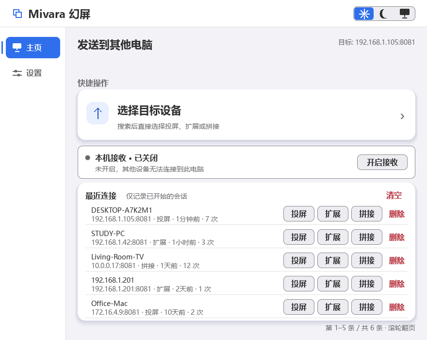
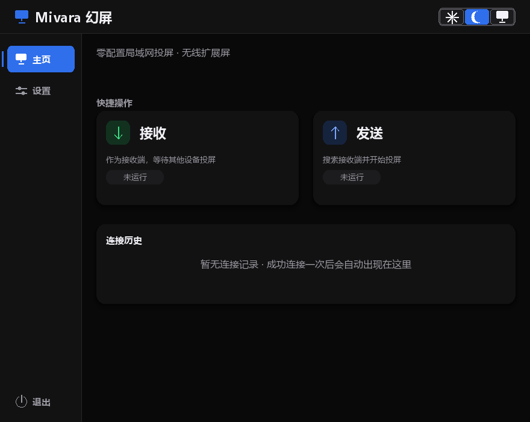
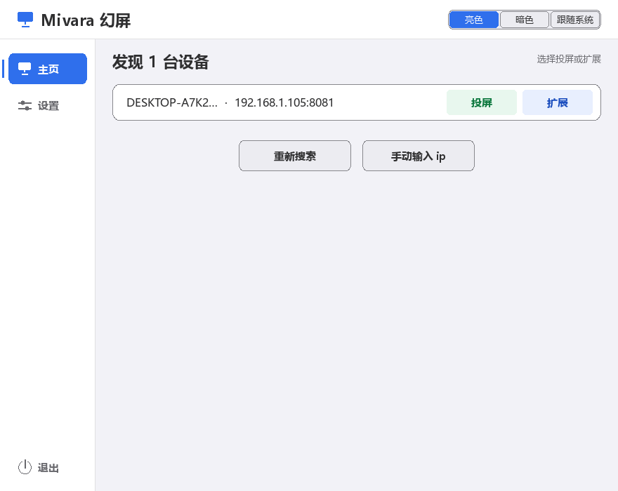
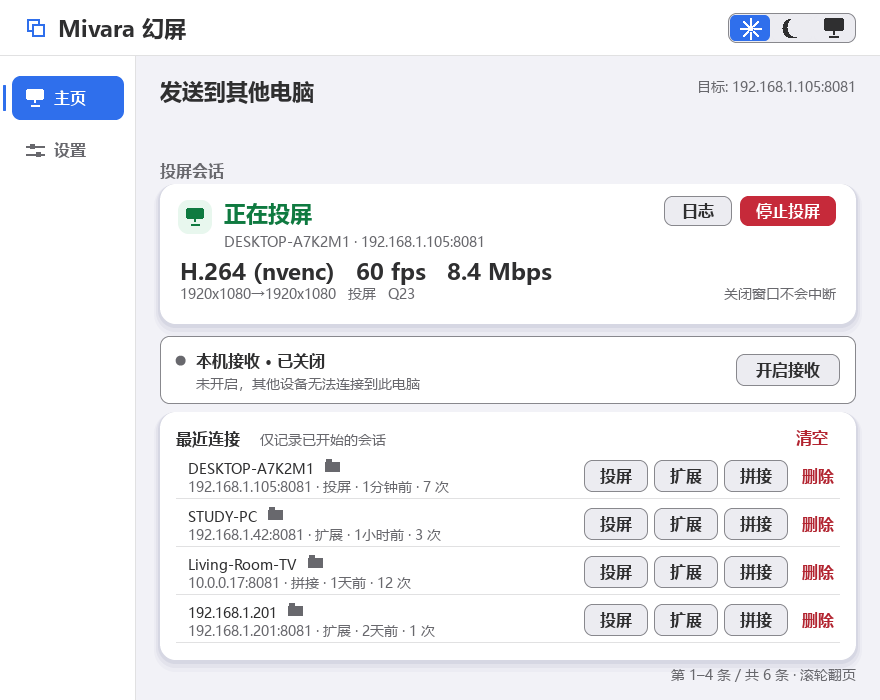

# User Guide

> [Docs index](../README.md) · [Back to README](../../README_EN.md) · [中文](../zh/usage.md)

Mivara is a lightweight, cross-platform **screen extension / casting** tool. The sender captures the local screen and streams it over the network to the receiver, which displays it fullscreen.

Two display modes are provided, plus a "stitch" mode that sends no picture at all:

1. **Mirror** — the receiver shows the sender's primary screen in full (demos and presentations).
2. **Extend** — the sender **automatically activates a virtual display**, creating a real desktop workspace; windows and the mouse can be dragged into this "invisible screen" and the receiver shows it in real time. The virtual display is detached when the session ends.
3. **Stitch (software KVM)** — both PCs keep their own monitors and **share one keyboard and mouse**: choose which side of this PC the peer sits on (left / right / top / bottom) when starting, push the cursor out of that edge to take over the peer, and move back out of the peer's facing edge (or press Ctrl+Alt+Shift+Q) to hand control back. The side can be switched at any time during the session. No capture, no encoder, no virtual display; Windows ↔ Windows only.

Extend mode requires a Windows indirect display driver (IddCx); see [Virtual Display Driver](virtual-display.md) for installation. The driver only needs to be installed once — attaching/detaching the virtual display is managed automatically during the session.

This page covers day-to-day use: the interface and capabilities first, then connecting by display mode. For discovery, handshakes and streaming internals, see [Architecture & Protocol](architecture.md).

## Screenshots

The GUI is Chinese-only; the screenshots below show the Home screen (light/dark), device discovery, and an active stream:

| Home (light) | Home (dark) |
|:---:|:---:|
|  |  |

| Device discovery | Streaming |
|:---:|:---:|
|  |  |

## Features

| Category | Capability |
|----------|-----------|
| **Extend mode** | Virtual display auto-enabled and attached at session start; on every exit path (normal end / Ctrl+C / disconnect / console close / hard-kill fallback) it is detached and the device is disabled, so it vanishes from system settings completely |
| **Virtual display integration** | Activation/deactivation/positioning done in-process via the CCD API — no manual display-settings fiddling |
| **Video codecs** | H.264 / H.265 / AV1 (FFmpeg), hardware-first (NVENC/QSV/AMF/VAAPI) with automatic software fallback (libx264/libx265/SVT-AV1); raw/RLE lossless options kept |
| **Live reconfigure** | Change codec/quality/bitrate/fps/scale/chroma mid-session — applied in seconds without dropping the stream (codec switches blip for a frame or two) |
| **Visible cursor** | The pointer is drawn into the video frames; in extend mode this equals "pointer crossing" |
| **Direct connect** | `sender <IP>` skips discovery — works when SSDP multicast is blocked by network policy |
| **Discovery** | Zero-config SSDP (UDP 1900 multicast + broadcast fallback); concurrent NIC listeners, a total deadline and cancellation; the first device appears immediately and later devices are added incrementally |
| **Connection history** | Last 20 sessions that actually started, embedded on Home — one-click direct connect, no search; failed connections add no entry |
| **Stitch (software KVM)** | One keyboard/mouse drives two Windows PCs: low-level input hooks + Raw Input, forwarded over TCP 8084 and injected on the peer with `SendInput`; shares the same receive policy as cast/extend (Windows only) |
| **Stitch file drop (optional)** | Drag to the shared edge and release over an Explorer/desktop folder on the peer; copy-only, never moves or deletes the source, collisions are renamed; off by default on both ends (Windows only) |
| **Two-way file transfer (optional)** | Click the folder icon beside a recent computer name to browse local/remote directories with multi-select, a transfer queue, new folder, direct path entry, hidden items and both device names; the page can detach into its own window. TCP 8086, separate opt-in off by default, normal connection authorization, SHA-256 verification and no overwriting; collisions get a numeric suffix, over-long stems are truncated to the local component limit, the client dials numeric IPs only, and protocol v2 requires both ends to be the same build |
| **Connection authorization** | Three mutually exclusive policies: allow any connection (risk warning, never the default) / password only (4–8 characters, letters are case-insensitive, never sent over the wire; an over-long entry is reported, never silently truncated) / manual approval for every connection (the default; 30 s timeout auto-denies, duplicate requests merge, one prompt at a time); a new install or a missing config always falls back to manual approval |
| **GUI** | SDL2_ttf interface: left nav (Home / Settings), connect-device entry, low-weight receive status bar, connection history, automatic search, device list (cast/extend/stitch), manual IP entry, collapsible technical details, independent log window; Settings is split into General / Quality & Codec / Receiving & Security |
| **Close to tray** | On Windows the close button only hides the window and the session keeps running; click the icon to restore, right-click for Show / Quit; launching again wakes the running instance; hiding and quitting never change receive settings |
| **Auto-start / auto-receive** | Launch at logon (Windows Task Scheduler, no UAC prompt; applied on Save and verified by reading the task back); "Allow other devices to connect" is the live switch (starts/stops immediately, not persisted), while "Start receiving when the app opens" is the only persisted startup preference (off by default); starting or stopping receive manually never changes it |
| **Update check** | A "Check for updates" button in Settings plus an automatic check at launch (on by default, at most once per 24 h per machine, can be turned off). A new release can be downloaded in-app (size + SHA-256 verified) and installed with one click, or opened on the release page for a manual download. Only the GitHub release source is contacted; no local data is uploaded |
| **Performance** | Up to 120 FPS streaming, 4 MB socket buffers, TCP_NODELAY |
| **CPU offload** | RLE frame compression and color conversion offloaded to the receiver's CPU (TCP 8082, RLE mode only) |
| **Port inspector** | Remotely list/query/kill processes on any port of the receiver (TCP 8083) |
| **Cross-platform** | Linux (X11), Windows 10/11, macOS 10.15+ |

For the protocol and implementation behind each capability, see [Architecture & Protocol](architecture.md).

## Display Modes

| Mode | GUI button / CLI | Behavior |
|------|------------------|----------|
| Mirror | "Cast" / `--mode mirror` (default) | Receiver shows the sender's primary screen borderless fullscreen by default; press F11 to return to a resizable window |
| Extend | "Extend" / `--mode extend` | Sender auto-activates a virtual display; receiver shows it borderless fullscreen as a **real desktop workspace** — windows can be dragged in, the mouse crosses over |
| Stitch | "Stitch" / `--mode stitch` | No picture is sent: both PCs use their own monitors and share one keyboard/mouse (Windows only) |

> Earlier "simulated extend" variants (extend-right/below/left: fullscreen mirror with a blue seam line) were removed — they never created a real desktop workspace. Extend always uses `--mode extend` (protocol mode 1).

Extend mode relies on the Windows virtual display driver, which the installer offers by default; installation and resolution configuration are covered in [Virtual Display Driver](virtual-display.md). Before connecting, the sender probes the receiver's current resolution and matches the virtual display to it. If the driver's mode list lacks that size, it is appended by default (`vdd_mode_write=never` disables this); if writes are disabled or fail, the receiver centres the picture with black bars instead of stretching it.

### Stitch (software KVM)

Stitch turns two Windows PCs sitting side by side into one workspace **without duplicating any picture**: machine A's desktop stays on A's monitor and B's on B's monitor — only the keyboard and mouse cross over.

- **Entry point**: click "Stitch" on a device row or in the connection history — a dialog first asks which side of this PC the peer sits on (left / right / top / bottom, preselected from the last answer); the CLI equivalent is `bin/sender <IP> --mode stitch --stitch-side left|right|top|bottom` (port 8084 — never point it at the video port).
- **Requirements**: both ends must be Windows and run the same Mivara version; the target must be serving ("Start receiving" in the Home status bar, or run `bin/receiver`).
- **Authorization**: stitch uses the same Receiving & Security policy as cast/extend and never adds a second confirmation. With manual approval the dialog shows the device name, IP and "Request: stitch control (keyboard and mouse)"; with a password the sender asks for it first; "allow any connection" connects directly. Manual approval auto-denies after 30 s, and a refusal suppresses prompts from that source for 60 s.
- **Busy**: one stitch controller at a time; another connection is told "the peer is receiving another connection" immediately instead of queueing. Cast/extend and stitch also share one active-session slot, so while either mode has a session the other port answers BUSY immediately.
- **Choosing a side**: the side means **where the peer sits relative to this PC**, and it decides both the local edge the cursor leaves through and the peer's edge it enters from. Right: leave the local right edge, enter at the peer's left edge, return by leaving its left edge. Left: leave the local left edge, enter at the peer's right edge, return through its right edge. Top: leave the local top edge, enter at the peer's bottom edge, return through its bottom edge. Bottom: leave the local bottom edge, enter at the peer's top edge, return through its top edge. `Ctrl+Alt+Shift+Q` always hands control back immediately.
- **Switching mid-session**: the status panel's "Direction" row offers the four sides; a click takes effect immediately. If control is currently on the peer it is handed back first, and the new side becomes the default for the next session. With "Status console" enabled the **sender** has no stdin channel, so a switch restarts the sender and reconnects — the authorization runs again. The receiver is unaffected: it always keeps its GUI control channel.
- **Stopping**: "Stop" in the status panel ends the session; closing the receiver window (or ESC/Q) disconnects immediately and releases every held key. Stopping receive mode from the GUI ends the receiver process directly, so a key or mouse button held at that instant may stay down on that PC until tapped once. The controller notices a normal peer exit or crash through its socket read side. With current builds on both ends, a network outage or power loss is detected by a heartbeat every 3 seconds with an approximately 9-second deadline, followed by release of held input.
- **Permissions**: a receiver launched from the GUI inherits the GUI's administrator token (the GUI needs elevation for extend mode), so stitch input can reach elevated windows; a standalone `bin/receiver` runs unelevated and cannot type into administrator windows.
- **Security**: the stitch channel is unencrypted and intended for a trusted LAN only; authorization decides *who may connect* and does not encrypt the input events. Either side can hand control back at any time.
- **File drop (optional, copy-only)**: enable "Allow the peer to send files" on the receiving side and "Drag to the edge to send files" on the sending side under Settings → General; both are off by default. If the send toggle changes while a stitch session is running, saving reconnects the session with the new setting (the peer consents again); the receiver toggle takes effect on save. During a stitch session, drag files or folders to the shared edge, move onto the peer and release over an Explorer window or the desktop: the items are **copied** into the folder under the release point (the desktop means the Desktop folder; a subfolder cell is also hit). The source is opened read-only and is **never moved, deleted or overwritten**; name collisions become `name (1).ext`. If the release point is not Explorer/the desktop (Notepad, a terminal, a game) or cannot be resolved, the items go to `%USERPROFILE%\Downloads\Mivara` (or `%LOCALAPPDATA%\Mivara\Received` when Downloads is not on a local fixed drive or cannot be created) and the log says so. Only real local files/folders dragged during the session are supported; virtual items such as files inside a zip or an email attachment, and elevated windows, are not. The file channel is unencrypted, so its contents are visible to other devices on the same LAN; use it on trusted networks only.
- **Reverse drag (target → controller)**: on the target's desktop (driven by the controller's mouse and keyboard), drag files or folders to the edge that FACES the controller and keep pushing about 24 px — control comes back to the controller **carrying the files**, with the source's real drag image next to the cursor (falling back to the icon card when unavailable); move to the spot you want on the controller's desktop and release. The items are copied there (falling back to the controller's `Downloads\Mivara` when that cannot be resolved). Ctrl+Alt+Shift+Q cancels the gesture and hands control back. This needs "Drag to the edge to send files" enabled on the target and "Allow the peer to send files" enabled on the controller — with both switches on at both ends, drag copy works in both directions, always copy-only.
- **Drag feel**: after crossing into the peer with a file drag, handing control back requires a deliberate pushback of about 24 px rather than any small pullback, so a natural pullback while aiming does not cancel the copy. A reverse drag does not hand control back at the edge immediately; it completes on release and then returns automatically. Ctrl+Alt+Shift+Q always forces control back.
- **Drag image**: once a file drag crosses to the peer, the peer shows the **source Explorer's real drag image** next to the cursor (icon/thumbnail, file name, shadow and translucency match the source view, with the same cursor offset); it disappears on release or cancel. If the source/peer is an older build, the drag source provides no drag image, or the image transfer is incomplete, it falls back to the self-drawn icon card: the item's own system icon or thumbnail (images and videos use their thumbnail; folders, apps and documents use their real Explorer icon) plus the file name and "N items", and finally to a page glyph if no icon is available. It is display-only and never touches the files.
- **Icon at the release point**: after the copy, the receiving side tries to place the new icons at the point where you released over the peer (extra items stack downwards). If that folder or the desktop has "auto arrange icons" enabled, Explorer re-snaps them to its own grid and that arrangement wins.

### Two-way File Transfer

- **Entry and requirements**: click the folder icon beside a computer name in Home → Recent connections. The peer must run a supporting version, start receiving, and enable "Allow file transfer" under Settings → General (off by default). No cast or stitch session is required first. The file protocol is v2, so **both ends must run the same build**; an older receiver answers with a version error.
- **Browsing**: the local machine is on the left and the peer on the right; the header shows the local name (本机) and the peer's name (远程, announced after connecting). The toolbar provides back, up, refresh, new folder and a hidden-items toggle; the path box accepts an absolute path (press Enter) and the ▾ button returns to drives/all locations. Click a row to select, double-click a directory to enter it, and use the checkboxes for multi-select (the header checkbox selects every visible row). Columns show name, modification date, type and size. At most the first 1000 entries per directory are listed; symlinks, reparse points, special files, and names that cannot be represented as one cross-platform path component (for example containing `/`, `\` or a control character) are skipped. Remote listings use a platform-independent name rule; names the local OS cannot create (Windows `: ? * " < > |`, reserved names, trailing dot/space, or over-long names) still appear and fail with a local path error only when downloaded.
- **Upload / download**: the "发送 →" button at the top of the left pane copies the checked local files into the right pane's current directory; "← 发送" at the top of the right pane copies the checked remote files into the local current directory. Multiple files can be queued at once; folders are reported and skipped rather than copied recursively. The per-file limit is 64 GiB.
- **Transfer list**: the panel below the panes lists each task's name, state, size, source path and destination path with a 本机/远程 badge. Tasks run one at a time in order. "全部暂停" stops starting further tasks (the active one continues), "全部开始" resumes, "全部取消" cancels queued items and stops the active one, and "清除完结" removes finished/failed/cancelled rows. Each row offers "定位" (jump to the source or destination directory) and "移除/取消".
- **New folder / hidden items**: the "＋" toolbar button creates 新建文件夹 (an automatic numeric suffix when the name exists) in either pane; remote creation follows the same authorization and "Allow file transfer" switch. The "隐" button toggles hidden entries (Windows hidden attribute; POSIX dot prefix). Hidden is a display filter only, not an access control.
- **Integrity and collisions**: data travels in 64 KiB chunks with SHA-256 verification. The receiver writes a temporary file beside the destination and commits only after verification. Existing names are never overwritten; collisions are preserved as `name (1).ext`, and so on. When the stem is too long, it is truncated on a full UTF-8 character boundary to the local filesystem's component limit, keeping the numeric suffix and the extension when possible. Failure or cancellation removes only its own temporary file, and the source remains read-only.
- **Authorization and concurrency**: the peer's allow-any / password / manual policy still applies, with a file-specific proof purpose; manual approval explicitly says browse, upload and download. TCP 8086 has its own single-client slot and can coexist with casting or stitching. Turning off "Allow file transfer" on the peer rejects the next request even on an already-open connection.
- **Detached window**: "分离" moves the page into its own window while the main window stays usable; "合回" in that window returns it. Settings → General → "Detach file-transfer window by default" only affects the next open. Closing the detached window ends the file connection; hiding to the tray hides both windows. Cancelling an upload keeps the connection and the queue alive; cancelling a download needs a reconnect, after which "重新连接" resumes.
- **Cancel and leave**: "取消当前" stops the active item (an upload sends ABORT and reuses the connection; a download closes it), after which "重新连接" starts a fresh one. Back, ESC or entering Settings ends the file connection; hiding to the tray does not interrupt it, and quitting asks before cleaning up the worker.
- **Security**: paths and file contents are plaintext. Authorization is not encryption and does not authenticate the peer's identity. Use trusted LANs only and never expose 8086 publicly; on Windows, a GUI-launched receiver inherits administrator rights, so enable access only for a peer you trust. Creating a folder is a remote write and belongs to the same trusted-network boundary.

## GUI

Launching the GUI is recommended:

```
bin/app
```

The top-right of the header holds the **appearance switcher** — three icons: sun = Light, moon = Dark, monitor = Follow system. The left side holds the nav bar: **Home** (connect device + receive status bar + connection history) and **Settings** (General / Quality & Codec / Receiving & Security):

- **Appearance**: three icons in the header (sun = Light, moon = Dark, monitor = Follow system); one click recolours the window and writes `theme` to `config.ini`, with no Save needed. For "Follow system", see the platform note in [Settings & History](#settings--history)
- **Home · Connect device**: click "Select target device" to open discovery; searching can be cancelled and results appear incrementally. Each row directly offers "Cast" (mirror the picture), "Extend" (add a desktop) or "Stitch" (share input, no picture) — there is no separate confirm-device-then-choose-mode step. Stitch asks for a direction first
- **Home · Receive status bar**: the low-weight bar below the connect entry shows the receiver's real state — off / starting / waiting for connection / waiting for approval / receiving / failed to start — and its action follows that state (Start receiving / Stop receiving / Retry / Go to Settings). Configuration errors such as a corrupt password record offer "Go to Settings"; click the bar for the local address and receive details
- **Home · Connection history**: only sessions that actually started are recorded — video has started streaming, or a stitch session has been established. Discovery, connection probes, denied authorization and launch failures add no entry. For the last 20 entries, click a row to reconnect with its last mode or choose another mode directly; the folder icon beside the computer name opens two-way file transfer; delete one, clear all, or scroll with the mouse wheel
- **Home · In session**: Home keeps the target, current mode, connection state and Stop action visible. You can switch to Settings without interrupting the session, then use "Back to session" to return to live status. ESC on a cast or receive session screen only returns Home; **it does not stop the session**
- **Settings · General**: "Startup" contains start receiving on app launch, launch at logon, the stitch file-drop and two-way file-transfer switches, and "Detach file-transfer window by default"; "Updates & diagnostics" contains the status console, log window and automatic update checks; "Software update" sits below
- **Settings · Quality & Codec**: the left column has codec (auto/H.264/H.265/AV1/raw/RLE), quality, FPS, bitrate, scale and chroma; the right column has hardware acceleration. **Changed transfer parameters apply live when you save — the stream is not dropped**
- **Settings · Receiving & Security**: see the next section
- **Settings · Update & Save**: the bottom of General shows the current version and check result; a new release offers "Download update" (with progress) → "Install now" (Windows: after verification the app quits and starts the installer; Linux/macOS: opens the release page). You can "Ignore this version". Apart from immediate controls such as appearance and the receive switch, changes are committed with "Save settings". Cancel or ESC goes back, asking first when edits are unsaved; "Restore defaults" changes the working copy and writes only when saved. A failed save keeps the edits and explains the error
- **No devices found**: three options — "Keep searching", "Enter IP manually", "Exit"; a manually entered IP leads to the same three direct mode choices. If a connection fails or no receiver is ever found, see [Troubleshooting](troubleshooting.md)
- **Cast / Extend status**: the target, current mode and connection phase are prominent; waiting for approval is never presented as connected. Technical details are collapsed by default — expand "Connection details" for FPS / bitrate / encoder and other parameters. Failures retain the target and offer Back / Retry / Log, while Stop remains a separate action
- **ESC**: cancel local edit/choice dialogs, or deny a connection-approval request; Settings asks about unsaved edits before leaving, otherwise goes back; every other non-Home screen returns Home, and Home does nothing. ESC on the file-transfer page also disconnects it; while a path box is being edited the first ESC only leaves the edit, and the same applies in the detached window; otherwise ESC never stops a session managed by the main window; for ESC / Q in the receiver's own video window, see below

## Receiving & Security

"Settings → Receiving & Security" controls the live receive switch and authorization; "Settings → General" contains the two startup preferences.

### Three switches

| Switch | Default | Description |
|--------|---------|-------------|
| Allow other devices to connect to this computer | off (at launch) | **The live receive switch.** Turning it on starts the receive service; turning it off stops it (neither 8081 nor 8084 listens) and the Home bar changes accordingly. It affects this run only and is **not written to config**: whether the next launch receives is decided solely by "Start receiving when the app opens" |
| Start receiving when the app opens | off | **The only persisted startup preference.** When on, every launch starts receiving regardless of how the previous run ended; when off, a launch does not receive even if it was receiving before exit |
| Auto-start | off | Registers a Windows Task Scheduler job (onlogon, no UAC at logon); applied on Save and read back from Task Scheduler, with the switch reverting to the real state if registration fails. It only launches the app — whether it receives is decided by the row above. Windows only |

Auto-start and the receive switches are independent: starting or stopping receive manually never changes the startup preference, and auto-start never changes whether the app receives.

### The three authorization policies (mutually exclusive)

| Policy | Behavior |
|--------|----------|
| Allow any connection | No password check, no prompt: any device that can reach the port is connected. The settings page shows a risk warning; this is **not the default**, and a new install or missing config never lands here |
| Password only | Requires a 4–8 character connection password (letters are case-insensitive; not empty or all spaces; more than 8 characters is reported as a length error, never silently truncated). Only a PBKDF2 record is stored locally (the plaintext never touches disk or the network); the sender answers a fresh nonce with a proof that is domain-separated per port. The receiver can "Set / Change" the password in Settings (a single field, show/hide), and the sender's field supports paste and show/hide too. Repeated failures share one cooldown across cast, stitch and file transfer |
| Manual approval (default) | Every new connection prompts with the device name, IP and request type; "Allow once" or "Deny", default Deny, auto-denied after 30 s. Repeated requests from the same device while the prompt is open merge into one; only one prompt exists at a time, and another device's request is answered "busy". A second connection while a session is active is answered "busy" immediately instead of queueing |

On failure the sender distinguishes **wrong password / denied by the peer / approval timed out / peer busy / network unreachable / incompatible version / receive service not running**, and never shows the password itself.

> **A password is not encryption.** The connection password is only an admission check; the video stream, stitch input events and file contents are **not encrypted**, so other devices on the link can still capture them. The UI never claims that the picture is encrypted.

## Closing to the Tray (Windows)

- Click the window close button: the window hides to the notification area and the **running session continues**; the first hide shows a one-time balloon hint.
- Click the tray icon, or right-click → "Show main window": restores the window. If a device asks for approval or the receive service fails while hidden, the window is restored and a balloon appears, so the request is never missed.
- Right-click → "Quit": ends the app. With a live session it asks first, then fully stops the children, closes connections, releases ports and detaches the virtual display.
- Launching the app again does not create a second instance — it wakes the window that is already running.
- Hiding or quitting never changes startup preferences such as "Auto-receive"; the live receive switch affects this run only and is not written to config.

On Windows you can also use the convenience scripts in `scripts/`: `start_receiver.bat` starts the receiver in one click; `启动投屏发送.bat <receiver-IP>` direct-connects and sends.

## Receiver Keys

| Key | Action |
|-----|--------|
| ESC / Q | Disconnect and quit |
| F11 | Toggle fullscreen / window (both mirror and extend modes) |
| Close window | Stop receiving |

## Sender Keys

| Input | Action |
|-------|--------|
| Ctrl+C | Graceful exit (virtual display detached + device disabled) |
| Mode prompt 1/2/3 | Mirror / Extend / Stitch (interactive CLI only) |
| Ctrl+Alt+Shift+Q | Stitch mode: hand the keyboard/mouse back immediately |

## Settings & History

The GUI Settings screen (persisted to `%LOCALAPPDATA%\Mivara\config.ini`):

| Setting | Default | Description |
|---------|---------|-------------|
| Appearance | follow system | Light / Dark / Follow system; the header switcher applies instantly and writes `theme` to `config.ini`, so it needs no Save |
| Codec | H.264 | auto/H.264/H.265/AV1/raw/RLE |
| Hardware accel | on | Prefer GPU encoding |
| Quality / Bitrate | 23 / 0 | Bitrate > 0 uses bitrate mode, otherwise CRF |
| FPS / Scale | 60 / 100% | Sender cap and pre-downscale |
| Chroma | 4:2:0 | 4:4:4 = sharper text (software encode) |
| Status console | off | Shows the classic cmd window for children; the receiver's authorization/status channel is always kept, and its log is also available in the in-app log window |
| Log window | off | Auto-open the independent log window |
| Auto-start | off | Registers a Windows Task Scheduler job (onlogon, no UAC at logon); applied on Save and read back from Task Scheduler, with the switch reverting to the real state if registration fails; cleaned up on uninstall |
| Allow other devices to connect | off (at launch) | Live receive switch; on/off starts/stops the 8081/8084 listeners immediately and is not written to config |
| Start receiving when the app opens | off | The only persisted startup preference; when on, every launch receives, and stopping manually does not change it |
| Allow file transfer | off | Lets an authorized peer browse, upload, download and create folders over 8086; independent of stitch file drop, and disabling it also rejects the next request on an existing connection |
| Detach file-transfer window by default | off | Opens the file-transfer page in its own window next time; the current session can still toggle 分离 / 合回 from the page |
| Authorization policy | manual approval | Allow any connection / password only / manual approval; a missing or corrupt config falls back to manual approval |
| Connection password | unset | Password mode only; 4–8 characters (letters are case-insensitive), stored locally as salt + PBKDF2 record, never sent over the wire |
| Auto update check | on | Checks for a new release ~3 s after launch (at most once per 24 h per machine); when off, only the manual button goes online |

A few options exist only in `config.ini`: `extend_res` (`auto` or `WxH`, default `auto`) forces the virtual-display size; `vdd_mode_write` (`always` / `never`, default `always`) controls whether the receiver's resolution may be added to `vdd_settings.xml` (no prompt any more; an old `ask` value is treated as `always`); `stitch_side` (`left` / `right` / `top` / `bottom`, default `right`) stores the stitch direction, rewritten whenever it is chosen in the launch dialog or switched mid-session; and `file_transfer_detach` (`0` / `1`, default `0`) controls whether the next file-transfer page opens in its own window. Security fields are `auto_receive`, `auth_mode`, `auth_salt`, `auth_hash`, `auth_iter` and `tray_hint_shown`; a legacy `allow_receive` key is ignored and no longer written; an unknown `auth_mode` is read as `manual`, and `auth_salt`/`auth_hash` are verification records only — the plaintext password is never present.

> "Follow system" reads the OS light/dark preference. Windows reads the `AppsUseLightTheme` registry value and re-checks it every 2 s, so flipping the OS theme is followed immediately; macOS (`AppleInterfaceStyle`) and Linux (GNOME `color-scheme`) are sampled once at startup, so an OS theme change needs a restart of the app there. A failed probe always falls back to light.

**Live reconfigure**: while streaming, change any transfer parameter in Settings and press Save — it takes effect within seconds without dropping the connection (codec/scale switches blip for a frame or two). In classic console mode there is no stdin channel, so the session is restarted with the new parameters instead.

Technical details are collapsed on the session screen by default; expand "Connection details" for live FPS / bitrate / encoder, or open the independent log window for child-process output. The cmd console is hidden by default and can be re-enabled in Settings.

The connection-history list (`history.ini`, last 20 sessions that actually started) sits under the connect entry and receive status bar on Home — click to reconnect directly with the last mode (cast/extend/stitch), without searching; individual entries can be deleted or cleared.
