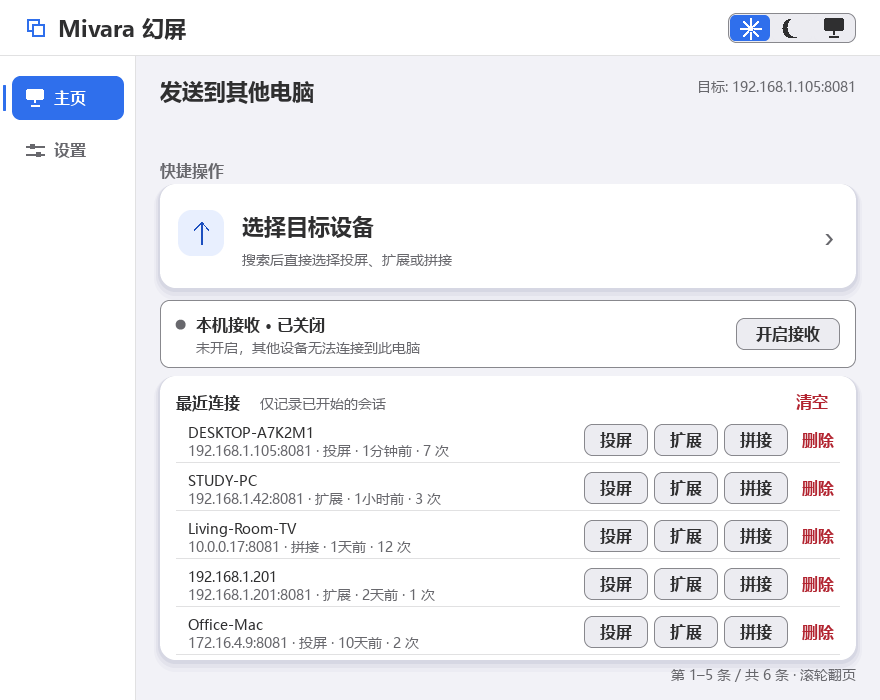
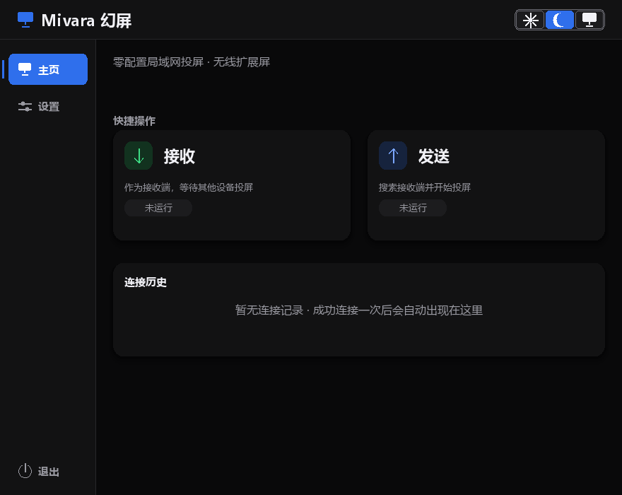
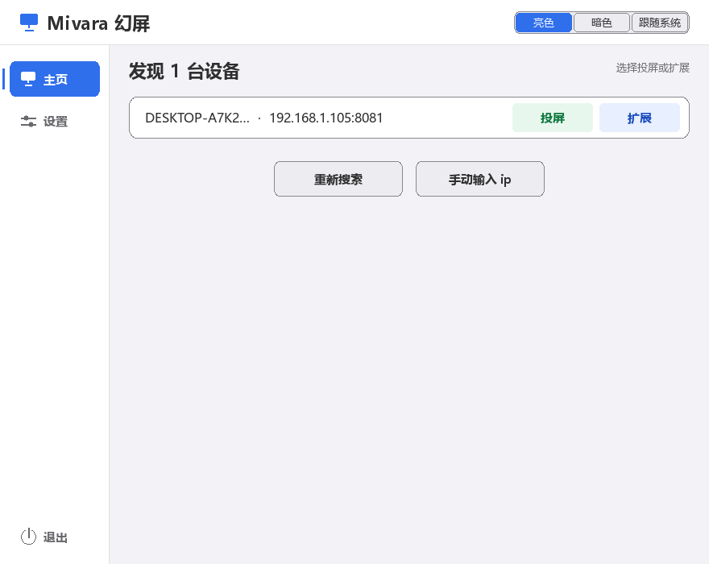
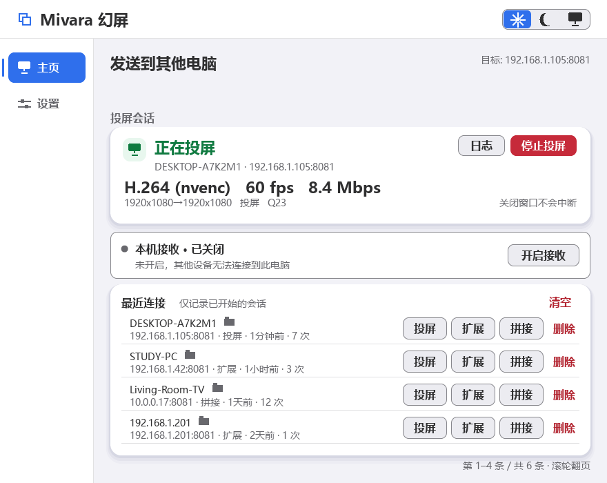

# 使用指南

> [文档索引](../README.md) · [返回 README](../../README.md) · [English](../en/usage.md)

Mivara（幻屏）是一个轻量级、跨平台的**屏幕扩展/投屏**工具。发送端（sender）采集本机画面，通过网络推流到接收端（receiver），接收端全屏显示。

项目提供两种显示模式，外加一种不传输画面的「拼接」模式：

1. **镜像投屏** —— 接收端显示发送端主屏的完整画面（演示/展示场景）
2. **扩展屏** —— 发送端**自动激活虚拟显示器**，创建一块真实的桌面空间；窗口和鼠标可以直接拖入/移入这块"看不见的屏幕"，接收端实时显示。会话结束时虚拟显示器自动关闭。
3. **拼接（软件 KVM）** —— 两台电脑各自使用自己的显示器，**只共享一套键盘和鼠标**：启动时选择对方在本机的左侧/右侧/上方/下方，从该侧移出光标即接管对方，移出对方屏幕的对应边缘（或按 Ctrl+Alt+Shift+Q）交还；会话中还能随时切换方向。不采集画面、不编码、不创建虚拟显示器，仅适用于 Windows ↔ Windows。

扩展模式需要 Windows 间接显示驱动（IddCx）支持，安装方法见[虚拟显示器驱动](virtual-display.md)。驱动只需安装一次；虚拟显示器的开/关由程序在会话期间自动管理。

本页面向实际使用：先看界面与功能，再按显示模式连接；程序内部如何发现、握手与推流，见[架构与协议](architecture.md)。

## 界面预览

图形界面为中文界面，下图依次为主页（亮色/暗色）、设备发现与投屏中的状态：

| 主页（亮色） | 主页（暗色） |
|:---:|:---:|
|  |  |

| 设备发现 | 投屏中 |
|:---:|:---:|
|  |  |

## 功能一览

| 类别 | 能力 |
|------|------|
| **扩展屏** | 会话开始自动启用并挂载虚拟显示器，任何退出路径（正常结束 / Ctrl+C / 断开 / 关窗 / 强杀兜底）都分离并禁用设备，彻底从系统设置消失 |
| **虚拟显示器集成** | 程序内完成激活/停用/定位（CCD API），无需手动操作显示设置 |
| **视频编码** | H.264 / H.265 / AV1（FFmpeg），硬件优先（NVENC/QSV/AMF/VAAPI）自动回退软件（libx264/libx265/SVT-AV1）；保留原始/RLE 无损选项 |
| **运行时调参** | 传输中随时改编码/画质/码率/帧率/缩放/色度，秒级热生效不断流（换编码瞬断一两帧后恢复） |
| **鼠标可见** | 光标直接绘制进视频帧；扩展模式下即"指针穿越" |
| **直连模式** | `sender <IP>` 跳过发现阶段，SSDP 多播被网络策略拦截时仍可连接 |
| **发现** | SSDP（UDP 1900 多播 + 广播兜底）零配置发现，多网卡并行监听、整次限时且可取消；首台设备立即显示，后续设备增量加入 |
| **连接历史** | 主页内嵌最近 20 条真正开始的会话，一键直连免搜索；失败连接不新增记录 |
| **拼接（软件 KVM）** | 一套键鼠控制两台 Windows 电脑：低层键鼠钩子 + Raw Input，经 TCP 8084 转发，对端 `SendInput` 注入；与投屏/扩展共用同一接收策略（Windows only） |
| **拼接文件投放（可选）** | 拖到共享边、松手在对方的资源管理器/桌面落点文件夹；仅复制，不移动或删除源文件，同名自动改名；两端默认关闭（Windows only） |
| **双向文件传输（可选）** | 最近连接的计算机名旁点文件夹图标，双栏浏览本机/对端目录，支持文件多选、传输队列、新建文件夹、直接输入路径、显示隐藏项和本机/远端设备名；可分离为独立窗口。TCP 8086，独立开关默认关闭，沿用连接授权，SHA-256 校验且不覆盖同名文件；同名副本自动加序号，超长基本名按本机组件上限截短；客户端只连接数字 IP，协议 v2 要求两端同时升级 |
| **连接授权** | 三种互斥方式：允许任意连接（风险提示、非默认）/ 仅允许密码连接（4–8 个字符，字母不区分大小写，密码不出网，超长输入会提示而不是静默截断）/ 每次手动授权（默认方式，30 秒超时自动拒绝，重复请求合并，同一时刻只显示一个授权请求）；新装或配置缺失时一律回落到每次手动授权 |
| **图形界面** | SDL2_ttf 中文 GUI：左侧导航（主页/设置）、连接设备、低权重接收状态栏、连接历史、自动搜索、机器列表（投屏/扩展/拼接）、手动输入 IP、可折叠技术详情、独立日志窗口；设置分「常规 / 画质与编码 / 接收与安全」三页 |
| **关闭到托盘** | Windows 下关闭按钮只隐藏窗口，会话继续；单击托盘图标恢复，右键「显示主界面 / 退出」；重复启动会唤醒已运行实例；隐藏和退出都不会偷偷修改接收设置 |
| **自启动 / 自动接收** | 开机自启动（Windows 计划任务，登录免 UAC；点「保存设置」后注册并回读真实状态）；「允许其他设备连接到此电脑」是当前运行开关（立即启停、不落盘），「启动软件时自动开启接收」是唯一持久化的启动偏好（默认关），手动启停接收不会改变它 |
| **检查更新** | 设置页「检查更新」按钮 + 启动自动检查（默认开，同一台机器每 24 小时至多一次，可在设置中关闭）；发现新版本可应用内下载安装包（校验大小与 SHA-256）后一键安装，或打开发布页手动下载。只访问 GitHub 发布源，不上传任何本地数据 |
| **性能** | 120 FPS 推流、4 MB 流 socket 缓冲、TCP_NODELAY 优化 |
| **CPU 卸载** | RLE 帧压缩与色彩修正可卸载到接收端 CPU（TCP 8082，仅 RLE 模式） |
| **端口检查器** | 远程列出/查询/终止接收端任意端口进程（TCP 8083） |
| **跨平台** | Linux（X11）、Windows 10/11、macOS 10.15+ |

各能力对应的协议与实现位置见[架构与协议](architecture.md)。

## 显示模式

| 模式 | GUI 按钮 / 命令行 | 行为 |
|------|------------------|------|
| 镜像 | 「投屏」/ `--mode mirror`（默认） | 接收端默认无边框全屏显示发送端主屏画面；按 F11 可切回可缩放窗口 |
| 扩展 | 「扩展」/ `--mode extend` | 发送端自动激活虚拟显示器；接收端无边框全屏显示这块**真实桌面空间**——窗口可拖入、鼠标可穿越 |
| 拼接 | 「拼接」/ `--mode stitch` | 不传输画面：两台电脑各用各的显示器，只共享一套键鼠（Windows 专用） |

> 早期版本的"模拟扩展"（extend-right/below/left：接收端全屏显示主屏画面并画一条蓝色拼接线）已移除——它们并不创建真实桌面空间。扩展一律使用 `--mode extend`（协议 mode 1）。

扩展模式依赖 Windows 虚拟显示器驱动，安装器默认提供并安装，配置见[虚拟显示器驱动](virtual-display.md)。连接前会自动探测接收端当前分辨率并匹配虚拟显示器；若驱动列表里没有这个尺寸，默认追加写入（`vdd_mode_write=never` 可禁用），禁用或无法写入时接收端以黑边居中显示，绝不会拉伸。

### 拼接（软件 KVM）

拼接模式把两台 Windows 电脑并排变成一套工作台，但**不复制画面**：A 机的桌面仍显示在 A 的显示器上，B 机的桌面仍显示在 B 的显示器上，只有键盘和鼠标跨过去。

- **入口**：设备列表或连接历史里点「拼接」，会先弹窗选择对方在本机的哪一侧（左/右/上/下，默认上次的选择）；命令行等价于 `bin/sender <IP> --mode stitch --stitch-side left|right|top|bottom`（默认端口 8084，请勿改成视频端口）。
- **前提**：两端都必须是 Windows 且版本一致；接收端需要运行接收服务（主页状态栏「开启接收」或直接运行 `bin/receiver`）。
- **授权**：拼接与投屏/扩展使用同一套「接收与安全」策略，不会额外多弹一次确认。每次手动授权时，接收端弹出的窗口会显示设备名、IP 和「请求：拼接控制（键盘与鼠标）」；密码模式下发送端会先要求输入连接密码；「允许任意连接」则直接接入。手动授权 30 秒无操作自动拒绝，拒绝后 60 秒内同一来源再次连接会被直接拒绝。
- **忙碌**：同一时间只接受一个拼接控制器；另一个连接会立刻收到「对方正在接收其他连接」，不会排队。投屏/扩展与拼接还共享同一个活动会话槽：任一端已有会话时，另一端的连接也会立即收到「对方忙」。
- **切换方向**：方向表示**对方在本机的哪一侧**，它同时决定光标从本机哪条边移出、又从对方哪条边进入。右侧：推出本机右缘、从对方左缘进入，移回对方左缘交还；左侧：推出本机左缘、从对方右缘进入，移回对方右缘交还；上方：推出本机上缘、从对方下缘进入，移回对方下缘交还；下方：推出本机下缘、从对方上缘进入，移回对方上缘交还。任何时候都可以按 `Ctrl+Alt+Shift+Q` 强制交还。
- **会话中切换**：拼接会话全程待在**主页**——主页的拼接卡片显示目标设备、连接状态、控制状态和「方向」四个选项，点一下立即生效；若当时正在控制对方，会先交还控制再切换，并把新方向记为下次的默认值。若在设置里勾选了「状态控制台」（**发送端**在控制台模式下没有 stdin 通道），切换会重启发送端并重新连接，授权流程会再走一次；接收端不受影响——它始终保留 GUI 控制通道。
- **退出**：主页拼接卡片的「停止拼接」结束会话；关闭接收端窗口或以 ESC/Q 退出会立即断开并释放所有按住的键。从 GUI 点「停止」会直接结束接收进程，若那一刻正按住某个键或鼠标键，需在接收端按一下该键清除状态。对端正常退出或崩溃时，控制器会主动检测连接关闭；两端均为新版时，断网或断电通过每 3 秒一次的心跳在 9 秒内判定并释放按键。若只是本机网卡切换、Wi-Fi 漫游或对端重启导致连接中断，控制器会自动重连（主页卡片显示「正在重连拼接」和「连接中断，正在自动重连…」），期间可随时点「停止拼接」结束会话；断线时正在按住的键会由对端在判定失联后释放。接收端若使用「每次手动授权」或密码策略，自动重连会重新走一次授权弹窗 / 密码输入；无人应答时重连以授权超时结束，需要重新发起连接。
- **权限**：经 GUI 启动的接收端会继承 GUI 的管理员权限（GUI 为扩展模式需要提权），因此拼接输入可以作用到管理员窗口；单独运行 `bin/receiver` 不提权，管理员窗口收不到拼接输入。
- **安全**：拼接通道没有加密，仅用于可信局域网；授权只决定「谁可以接入」，不会加密键鼠事件。任一方都可以随时交还控制。
- **文件投放（可选，仅复制）**：在「设置 → 常规」分别开启「允许对端发送文件」（接收方）和「拖拽到边缘发送文件」（发送方），两端默认都关闭。保存后若发送开关发生变化且已有拼接会话，会自动按新配置重连（对端需重新确认）；接收方开关保存即生效。拼接会话中把文件或文件夹拖到共享边，移到对端后在资源管理器窗口或桌面上松手，文件会**复制**到松手位置所在的文件夹（桌面即桌面文件夹；子文件夹单元格也会命中）。源文件全程只读，**不会移动、删除或覆盖**；同名文件自动改名为 `名称 (1).扩展名`。落点不是资源管理器/桌面（例如记事本、终端、游戏）或无法识别时，优先保存到 `%USERPROFILE%\Downloads\Mivara`（若该目录不在本地固定卷或无法创建，则回退到 `%LOCALAPPDATA%\Mivara\Received`）并在日志中说明。仅支持会话期间从本机真实路径拖出的文件/文件夹；压缩包内、邮件附件等虚拟位置，以及管理员窗口，暂不支持。文件通道不加密，内容对同一局域网内的其他设备可见；仅在可信网络使用。
- **反向拖回（被控端 → 控制端）**：在被控端桌面上（通过控制端键鼠操作）把文件或文件夹拖到**面向控制端的边缘**，继续向外推约 24 像素——控制权会带着文件回到控制端，光标旁出现源端的真实拖拽图（拿不到时回退为图标卡片）；把光标移到控制端桌面的目标位置后**松手**，文件复制并落在该位置（落点无法识别时回退到控制端的 `Downloads\Mivara`）。中途按 Ctrl+Alt+Shift+Q 可取消并交还。被控端需要开启「拖拽到边缘发送文件」，控制端需要开启「允许对端发送文件」；两端各开两个开关即可双向使用，同样只复制、不移动源文件。
- **跨屏拖拽的手感**：文件拖拽进入对端后，返回本机需要**明确向外多推一段距离**（约 24 像素），而不是稍微回摆一下就弹回——这样可以避免你瞄准落点时的自然回摆把拖拽误取消。反向拖拽到边缘时控制不会立即交还，松手完成复制后自动交还；按 Ctrl+Alt+Shift+Q 可随时强制交还。
- **跟随拖拽图**：文件拖拽跨到对端后，对端屏幕上会在光标旁显示源端 Explorer 的**真实拖拽图**（图标/缩略图、文件名、阴影和半透明都与源端视图一致，位置同样按源端的光标偏移）；松手或取消即消失。若源端/对端是旧版本、拖拽源没有提供拖拽图，或图像传输不完整，则回退为自绘的图标卡片：显示拖拽项自己的系统图标或缩略图（图片、视频等有缩略图时显示缩略图，文件夹/程序/文档显示其在资源管理器中的真实图标）加上文件名与「等 N 项」；连图标也拿不到时用占位文件图形。它纯属显示，不改变任何文件。
- **图标落在松手位置**：复制完成后，接收端会尝试把新文件的图标摆到你对端松手的位置（多选时向下依次排列）。若该文件夹或桌面开启了「自动排列图标」，Explorer 会按自己的网格重排，此时位置以系统的自动排列为准。

### 双向文件传输

- **入口与前提**：主页「最近连接」中，计算机名右侧的文件夹图标打开文件传输页。对端需运行支持该功能的版本、开启接收，并在「设置 → 常规」打开「允许文件传输」（默认关闭）；无需先开始投屏或拼接。文件传输协议为 v2，**两端必须使用同一版本**，旧接收端会直接返回协议版本不兼容。
- **浏览**：左栏为本机、右栏为对端，栏顶显示本机名（标「本机」）和对端名（标「远程」；连接成功后由对端上报）。工具栏提供后退、上级、刷新、新建文件夹和隐藏项开关；路径框可直接输入绝对路径后回车跳转，右侧「▾」回到磁盘/全部位置。单击行选择文件，双击目录进入；复选框支持多选，表头复选框可全选当前可见项。列表显示名称、修改日期、类型和大小；单栏最多列举前 1000 项。符号链接、重解析点、特殊文件，以及无法表示为单个跨平台路径组件的名称（例如包含 `/`、`\` 或控制字符）不进入列表。对端列表按平台无关规则显示；本机不能创建的名称（Windows 的 `: ? * " < > |`、保留名、结尾点/空格或超长名称）仍会显示，下载时才提示本机路径错误。
- **上传 / 下载**：「发送 →」把左栏选中项复制到右栏当前目录，「← 发送」把右栏选中项复制到左栏当前目录（两个按钮都位于两栏顶部）。可勾选多个文件一次加入传输队列；文件夹会提示跳过，不递归传输。单文件上限 64 GiB。
- **传输列表**：页下方的「传输列表」显示每个任务的名称、状态、大小、发送路径和接收路径，并带「本机 / 远程」标记。任务按顺序一次执行一个；「全部暂停」停止启动后续任务（当前任务继续），「全部开始」继续，「全部取消」取消排队项并中止当前项，「清除完结」移除已完成/失败/已取消记录。每行提供「定位」（跳到源或目标目录）和「移除 / 取消」。
- **新建文件夹 / 隐藏项**：工具栏「＋」在当前目录创建「新建文件夹」（重名自动加序号），本机与对端都支持；对端创建同样受授权和「允许文件传输」开关约束。「隐」按钮切换是否显示隐藏项（Windows 按隐藏属性，POSIX 按点号前缀）；隐藏只是显示过滤，不改变访问权限。
- **完整性与重名**：64 KiB 分块传输并校验 SHA-256；接收方先写同目录临时文件，校验成功后再提交。已有同名文件不会被覆盖，会自动保留为 `名称 (1).扩展名` 等副本；副本基本名过长时会按本机文件系统组件上限在完整 UTF-8 字符边界截短（保留序号，扩展名在可能时保留）。失败或取消只清理本次临时文件，源文件始终只读。
- **授权与并发**：沿用对端「允许任意 / 密码 / 每次手动授权」策略，密码证明使用独立的文件传输用途标记；手动弹窗会明确显示「浏览、上传和下载文件」。8086 有独立单客户端槽，可与投屏或拼接同时进行；对端关闭「允许文件传输」后，已建立连接的下一个请求也会被拒绝。
- **分离窗口**：「分离」把文件页移到独立窗口，主窗口仍可正常使用；独立窗口中的「合回」返回主窗口。设置 → 常规的「文件传输窗口默认分离」只影响下次打开。关闭独立窗口等于结束文件连接；关闭到托盘会同时隐藏两个窗口。上传取消可保持连接继续后续队列；下载取消需要断开连接，可点「重新连接」后继续。
- **取消与离开**：传输中点「取消当前」会中止当前项（上传会发送 ABORT 并复用连接；下载会断开连接），之后可点「重新连接」。返回、ESC 或进入设置会结束文件连接；关闭到托盘不会中断，退出程序会先确认并完整清理后台线程。
- **安全**：目录路径与文件内容均为明文，授权不等于加密，也不验证对端身份。只在可信局域网使用，不要将 8086 暴露到公网；Windows 下，GUI 启动的接收端继承管理员权限，因此开启前必须确认信任该对端。新建文件夹属于对端写操作，同样只在可信网络使用。

## 图形界面

推荐直接启动 GUI：

```
bin/app
```

打开后顶栏右侧是**外观切换**（三个图标：太阳＝亮色、月亮＝暗色、显示器＝跟随系统），左侧为导航栏：**主页**（连接设备 + 接收状态栏 + 连接历史）、**设置**（常规 / 画质与编码 / 接收与安全）：

- **外观**：顶栏右侧三个图标（太阳＝亮色、月亮＝暗色、显示器＝跟随系统），点一下立即换色并写入 `config.ini`，不需要点「保存设置」。「跟随系统」见[设置与历史](#设置与历史)中的平台差异说明
- **主页 · 连接设备**：点「选择目标设备」进入发现页；搜索可取消，结果增量显示。每台设备右侧直接选「投屏」（镜像画面）、「扩展」（新增桌面）或「拼接」（共享键鼠，不传画面），不需要先确认设备再进入模式页；拼接会先询问方向
- **主页 · 接收状态栏**：连接入口下方的低权重状态栏，按接收端真实状态显示「本机接收 · 已关闭 / 正在开启 / 等待连接 / 等待授权 / 正在接收 / 开启失败」，右侧动作随状态变化（开启接收 / 停止接收 / 重试 / 去设置）。密码记录损坏等配置错误时动作是「去设置」；点击状态栏可查看本机地址和接收详情
- **主页 · 连接历史**：只记录真正开始的会话——视频已经开流，或拼接会话已经建立。搜索、连接预检、授权失败和启动失败不会新增记录。最近 20 条记录支持整行按上次模式重连，也可直接选其他模式；计算机名右侧的文件夹图标打开双向文件传输页；可删除单条、清空或用滚轮翻页
- **主页 · 会话中**：拼接会话从头到尾都在主页，没有单独的会话页：主页卡片显示目标设备、连接状态、控制状态、「方向」四向切换，以及「日志」和「停止拼接」；连接失败时同一张卡片保留失败原因，并提供「日志」「重试」「关闭」（关闭后回到连接卡，可重新搜索或手输 IP）。投屏/扩展仍保留会话页，主页显示目标设备、当前模式和停止入口；可随时切到「设置」（会话不停），再点「返回会话」回到实时状态。在投屏或接收会话页按 ESC 只返回主页，**不会停止会话**
- **设置 · 常规**：「启动」管理启动软件时自动开启接收、开机自启动，以及拼接文件投放、双向文件传输开关和「文件传输窗口默认分离」；「更新与诊断」管理状态控制台、日志窗口、自动检查更新；底部为「软件更新」
- **设置 · 画质与编码**：左列为编码方式（自动/H.264/H.265/AV1/原始/RLE）及画质、帧率、码率、缩放、色度，右列为硬件加速。**传输中修改参数并点「保存设置」即热生效，不断流**
- **设置 · 接收与安全**：见下一节
- **设置 · 更新与保存**：常规页底部显示当前版本与检查结果；发现新版本 → 「下载更新」（带进度）→「立即安装」（Windows：校验通过后退出应用并启动安装程序；Linux/macOS：打开下载页手动安装）。可「忽略此版本」。除即时生效的外观、接收开关等控件外，其他设置点「保存设置」保存；「取消」或按 ESC 返回，有未保存修改时先询问是否放弃；「恢复默认」先恢复编辑中的默认值，保存后才写入。保存失败时保留编辑内容并提示原因
- **未搜到设备**：提供「继续搜索」「手动输入ip」「退出」三个选项；手动输入 IP 后同样直接选择三种模式。连接失败或始终搜不到接收端时，见[故障排除](troubleshooting.md)
- **投屏 / 扩展状态**：突出目标设备、当前模式和连接阶段；等待授权不会提前显示为已连接。技术详情默认收起，点「连接详情」展开 FPS / 码率 / 编码器等参数；失败时保留目标并提供「返回」「重试」「日志」，停止始终有独立按钮
- **ESC**：本地编辑或选择弹窗中取消，连接授权弹窗中拒绝；设置有未保存修改时先询问，否则返回；其他非主页页面返回主页，主页不执行操作。文件传输页的 ESC 会同时断开文件连接；路径框正在编辑时第一次 ESC 只退出编辑；分离窗口中的 ESC 同样结束文件连接；其他情况下 ESC 不会停止主窗口管理的会话；接收端视频窗口的 ESC / Q 见下文

## 接收与安全

「设置 → 接收与安全」管理当前接收和授权方式；「设置 → 常规」管理两个启动选项：

### 三个开关

| 开关 | 默认 | 说明 |
|------|------|------|
| 允许其他设备连接到此电脑 | 关（启动时） | **当前运行的接收开关**。打开立即启动接收服务，关闭立即停止（8081/8084 都不再监听），主页状态栏随之显示「等待连接」或「接收已关闭」。它只改变本次运行，**不写入配置**：下次启动是否接收只看下面的「自动接收」 |
| 启动软件时自动开启接收 | 关 | **唯一持久化的启动偏好**。开启后，每次启动软件都会自动开始接收，不受上次手动停止影响；关闭后，启动时不接收，即使上次退出前正在接收 |
| 开机自启动 | 关 | 注册 Windows 计划任务（onlogon，登录免 UAC 弹窗）；点「保存设置」后生效并回读任务真实状态，注册失败会把开关改回实际状态。它只负责把软件拉起来，是否接收由上一项决定；非 Windows 平台不支持 |

「开机自启动」与接收开关互不影响：手动开启/停止接收不会修改启动偏好，开机自启动也不会改变是否接收。

### 三种授权方式（互斥）

| 方式 | 行为 |
|------|------|
| 允许任意连接 | 不做密码校验、不弹窗，任何能访问端口的设备都会直接接入。设置页会显示风险提示，**不是默认值**，新装或配置缺失时永远不会落到这一项 |
| 仅允许密码连接 | 要求输入 4–8 个字符的连接密码（字母不区分大小写；不能为空或全空白；超过 8 个字符会提示长度错误，不会静默截断）。密码只保存在本机（PBKDF2 记录，明文不落盘、不上网），发送端验证时用一次性随机数 + 按端口用途分离的 HMAC 应答。接收端可在设置里「设置 / 修改」密码（只需输入一次，可显示/隐藏），发送端输入框同样支持粘贴和显示/隐藏。连续输错会在投屏、拼接与文件传输之间共享冷却 |
| 每次手动授权（默认） | 每个新连接都弹窗，显示设备名、IP 与请求类型；可选「允许一次」或「拒绝」，默认拒绝，30 秒未选择自动拒绝。同一设备在弹窗未处理时的重复请求合并为一个；同一时刻只显示一个授权请求，另一个设备的请求会收到「对方忙」。已有会话时第二个连接直接返回「设备正忙」，不会排队 |

授权失败时发送端会区分提示：**密码错误 / 对方拒绝 / 授权超时 / 对方忙 / 网络不可达 / 版本不兼容 / 接收服务未开启**，提示中不会出现密码内容。

> **密码 ≠ 加密。** 连接密码只用于准入校验；画面、拼接键鼠事件与文件内容本身**不加密**，链路上的其他设备仍可能截获内容。界面中不会出现「已加密画面」之类的说法。

## 关闭到托盘（Windows）

- 点窗口关闭按钮：隐藏到通知区域，**正在进行的会话继续**；首次隐藏会弹一次气泡提示（只提示一次）。
- 单击托盘图标，或右键「显示主界面」：恢复窗口；隐藏期间有设备请求授权或接收服务出错，会自动恢复窗口并弹出气泡，不会因为窗口隐藏而错过选择。
- 右键「退出」：结束软件。若有活动会话，会先确认；确认后完整停止子进程、断开连接、释放端口并分离虚拟显示器。
- 再次双击桌面图标：不会开出第二个实例，而是唤醒已经运行的窗口。
- 隐藏或退出都不会修改「自动接收」等启动偏好；当前接收开关只影响本次运行，不写入配置。

Windows 下也可用 `scripts/` 中的快捷脚本：`start_receiver.bat` 一键启动接收端；`启动投屏发送.bat <接收端IP>` 直连发送。

## 接收端按键

| 按键 | 作用 |
|------|------|
| ESC / Q | 断开并退出 |
| F11 | 切换全屏 / 窗口（投屏与扩展模式均可） |
| 关闭窗口 | 停止接收 |

## 发送端按键

| 输入 | 作用 |
|------|------|
| Ctrl+C | 优雅退出（含虚拟显示器分离 + 设备禁用） |
| 模式提示处 1/2/3 | 镜像 / 扩展 / 拼接（仅命令行交互模式） |
| Ctrl+Alt+Shift+Q | 拼接模式：立即把键鼠交还本机 |

## 设置与历史

GUI「设置」页可配置（保存在 `%LOCALAPPDATA%\Mivara\config.ini`）：

| 设置 | 默认 | 说明 |
|------|------|------|
| 外观 | 跟随系统 | 亮色 / 暗色 / 跟随系统；顶栏右侧切换即时生效并写入 `config.ini` 的 `theme`，无需点「保存设置」 |
| 编码方式 | H.264 | 自动/H.264/H.265/AV1/原始/RLE |
| 硬件加速 | 开 | 优先使用 GPU 编码 |
| 画质 / 码率 | 23 / 0 | 码率>0 时按码率，否则 CRF |
| 帧率 / 缩放 | 60 / 100% | 发送端上限与预缩小 |
| 色度 | 4:2:0 | 4:4:4 文字更锐（软件编码） |
| 状态控制台 | 关 | 开启后子进程显示经典 cmd 窗口；接收端的授权与状态通道始终保留，日志也可在应用内日志窗口查看 |
| 日志窗口 | 关 | 启动时自动打开独立日志窗 |
| 开机自启动 | 关 | 注册 Windows 计划任务（onlogon，登录免 UAC 弹窗）；点「保存设置」后生效并回读任务真实状态，注册失败会把开关改回实际状态；卸载时自动清理 |
| 允许其他设备连接到此电脑 | 关（启动时） | 当前运行的接收开关；打开/关闭立即启动/停止监听 8081/8084，不写入配置 |
| 启动软件时自动开启接收 | 关 | 唯一持久化的启动偏好；开启后每次启动都自动接收，手动停止不改变此项 |
| 允许文件传输 | 关 | 允许通过现有授权的对端在 8086 浏览、上传、下载和新建文件夹；独立于拼接文件投放，关闭后对已建立连接的下一请求也生效 |
| 文件传输窗口默认分离 | 关 | 下次打开文件传输页时直接使用独立窗口；本次仍可在页面内用「分离 / 合回」切换 |
| 授权方式 | 每次手动授权 | 允许任意连接 / 仅允许密码连接 / 每次手动授权；配置缺失或损坏时回落到每次手动授权 |
| 连接密码 | 未设置 | 仅密码模式使用；4–8 个字符（字母不区分大小写），本机只保存 salt + PBKDF2 记录，密码不出网 |
| 自动检查更新 | 开 | 启动约 3 秒后检查新版本（同一台机器每 24 小时至多一次）；关闭后仅手动点「检查更新」时联网 |

另有几个仅 `config.ini` 可改的选项：`extend_res`（`auto` 或 `WxH`，默认 `auto`）手动指定虚拟显示器尺寸；`vdd_mode_write`（`always` / `never`，默认 `always`）控制是否允许把接收端分辨率写入 `vdd_settings.xml`（不再弹出询问；旧配置的 `ask` 按 `always` 处理）；`stitch_side`（`left` / `right` / `top` / `bottom`，默认 `right`）记录拼接方向，每次在启动弹窗或会话中切换时自动写入；`file_transfer_detach`（`0` / `1`，默认 `0`）控制下次打开文件传输页是否使用独立窗口。安全相关字段为 `auto_receive`、`auth_mode`、`auth_salt`、`auth_hash`、`auth_iter` 与 `tray_hint_shown`；旧配置里的 `allow_receive` 会被忽略且不再写入；`auth_mode` 的未知值一律按 `manual` 读取，`auth_salt`/`auth_hash` 只是校验记录，**不要**也不会出现明文密码。

> 「跟随系统」读取操作系统的浅色/深色偏好：Windows 读注册表 `AppsUseLightTheme` 并每 2 秒复查一次，系统切换即时跟随；macOS（`AppleInterfaceStyle`）与 Linux（GNOME `color-scheme`）只在启动时读取一次，改系统主题需重启软件生效。检测失败一律回退亮色。

**运行时调参**：传输过程中打开「设置」修改参数并点「保存设置」，参数秒级热生效、连接不断（编码/缩放切换会瞬断一两帧）。经典控制台模式下无 stdin 通道，将自动按新参数重启会话。

传输状态页默认收起技术详情；展开「连接详情」可查看实时 FPS/码率/编码器，也可另开独立日志窗口查看子进程输出。

「主页」的连接入口和接收状态栏下方即连接历史（`history.ini`，最近 20 条真正开始的会话），点击即可按上次模式直连（投屏/扩展/拼接），无需重新搜索；支持删除单条与清空。
